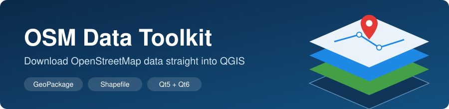
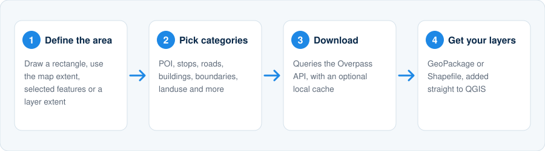
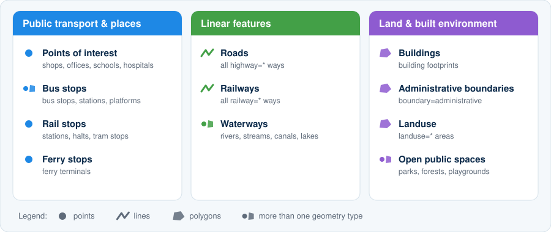
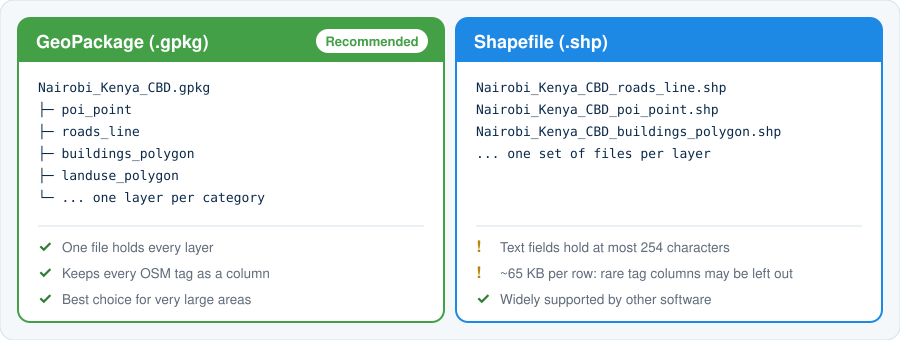
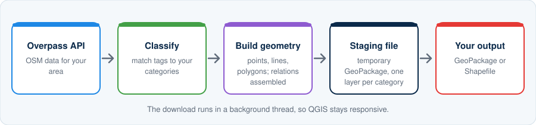

<p align="center">
  
</p>

<p align="center">
  
  
  
  
</p>

**OSM Data Toolkit** is a QGIS plugin that downloads [OpenStreetMap](https://www.openstreetmap.org) data for an area you choose and turns it into clean, organised layers, all without leaving QGIS. Pick an area, tick the kinds of features you need (buildings, roads, bus stops, boundaries and more), and the plugin does the rest.

## Contents

- [Features](#features)
- [How it works](#how-it-works)
- [Installation](#installation)
- [Quick start](#quick-start)
- [Screenshots](#screenshots)
- [Feature categories](#feature-categories)
- [Output](#output)
- [Under the hood](#under-the-hood)
- [Tips for large areas](#tips-for-large-areas)
- [Troubleshooting](#troubleshooting)
- [Compatibility](#compatibility)
- [Development](#development)
- [Data and attribution](#data-and-attribution)
- [Author](#author)
- [License](#license)

## Features

- **Four ways to define your area:** the current map extent, a rectangle drawn on the map, the bounding box of selected features, or the extent of a layer
- **11 feature categories** covering points of interest, public transport stops, roads, railways, waterways, buildings, administrative boundaries, landuse and open public spaces
- **Administrative level filter:** pick specific `admin_level` values (0 to 15) or download them all
- **GeoPackage or Shapefile output**, with clear file names built from your city, country, region and area names
- **Separate point, line and polygon layers** for each category
- **Relations handled:** multipolygon relations are assembled into polygons (with holes) where the data allows
- **Local cache** so repeating the same download is fast
- **Server fallback:** if one Overpass server fails, the plugin tries the next
- **Responsive interface:** downloads run in a background thread, with a live processing log
- **Optional auto-load** of the finished layers into your QGIS project
- Works on **QGIS 3.28+ (Qt5)** and **QGIS 4 (Qt6)**

## How it works

<p align="center">
  
</p>

1. **Define the area.** Draw it on the map or take it from your project.
2. **Pick categories.** Tick only what you need; smaller requests are faster and more reliable.
3. **Download.** The plugin asks the Overpass API for matching OSM data.
4. **Get your layers.** The result is saved as a GeoPackage or Shapefiles and can be added to QGIS automatically.

## Installation

### From the QGIS Plugin Manager

> Available once the plugin is published to the official QGIS plugin repository.

1. In QGIS, open **Plugins → Manage and Install Plugins…**
2. Search for **OSM Data Toolkit**.
3. Click **Install Plugin**.

### From a ZIP file

1. Download the latest plugin ZIP from the [Releases](https://github.com/martin-runguma/osm-data-toolkit/releases) page.
2. In QGIS, open **Plugins → Manage and Install Plugins… → Install from ZIP**.
3. Select the file and click **Install Plugin**.

### From source

Copy the `OSM_Data_Toolkit` folder into your QGIS plugins directory, then restart QGIS and enable the plugin in the Plugin Manager.

| Operating system | Plugins directory |
|---|---|
| Windows | `%APPDATA%\QGIS\QGIS3\profiles\default\python\plugins` |
| Linux | `~/.local/share/QGIS/QGIS3/profiles/default/python/plugins` |
| macOS | `~/Library/Application Support/QGIS/QGIS3/profiles/default/python/plugins` |

After installing, open the plugin from the **Plugins** menu or the toolbar icon.

## Quick start

### 1. Define the area of interest

| Option | How to use it |
|---|---|
| **Current QGIS map extent** | Pan and zoom the map to your area, then click **Update Current QGIS Map Extent**. |
| **Draw rectangle on map** | Click **Draw AOI**, then click and drag a rectangle on the QGIS map. |
| **Selected feature(s) in active layer** | Select features in a vector layer, make it the active layer, then click **Use Selected Features**. The bounding box of the selection is used. |
| **Active layer extent** | Make a layer active, then click **Use Layer Extent**. |

The coordinates (south, west, north, east) are shown in the dialog so you can check them before downloading.

### 2. Choose the feature categories

Tick the categories you need. **Select All** and **Clear All** help you start from either end. See [Feature categories](#feature-categories) for exactly what each one contains.

If you tick **Administrative boundaries**, you can also choose which administrative levels to download, or leave it on all levels.

### 3. Choose the output

- **Output format:** GeoPackage (recommended) or Shapefile
- **Output directory:** where the files will be saved
- **Automatically add downloaded layers to QGIS:** loads the results into your project when finished
- **Use local cache where available:** reuses earlier results for the same query

### 4. Download

Click **Download OSM Data**. A small window asks for a **city, country, region and area name**. These are joined into the output file name, for example `Nairobi_Kenya_NairobiCounty_CBD`. Click **Continue to Download** and watch progress in the **Processing Log**.

## Screenshots

<!--
Add your own screenshots to docs/images/ and uncomment the lines below.
Suggested files (PNG, about 900 px wide):

  docs/images/screenshot-dialog.png   The main plugin window
  docs/images/screenshot-aoi.png      Drawing an AOI rectangle on the map
  docs/images/screenshot-log.png      The Processing Log during a download
  docs/images/screenshot-result.png   The finished layers in QGIS

<p align="center">
  
</p>

<p align="center">
  
</p>

<p align="center">
  
</p>
-->

*Screenshots coming soon.*

## Feature categories

<p align="center">
  
</p>

| Category | What it selects (OSM tags) | Geometry |
|---|---|---|
| **Points of interest** | `shop`, `office`, `industrial`, and selected `amenity` (schools, hospitals, banks, restaurants, places of worship, and more), `leisure` and `building` values | Points |
| **Bus stops** | `highway=bus_stop`, `amenity=bus_station`, `public_transport=platform` or `station` | Points and polygons |
| **Rail stops** | `railway=station`, `halt`, `platform`, `tram_stop`, `subway_entrance` | Points |
| **Ferry stops** | `amenity=ferry_terminal` | Points |
| **Roads** | `highway=*` | Lines |
| **Railways** | `railway=*` | Lines |
| **Waterways** | `waterway=*`, plus water bodies such as `natural=water`, `wetland`, `bay` and `landuse=reservoir` | Lines and polygons |
| **Buildings** | `building=*`, plus `slum=yes` and `informal=yes` areas | Polygons |
| **Administrative boundaries** | `boundary=administrative` | Polygons |
| **Landuse** | `landuse=*`, plus `slum=yes` and `informal=yes` areas | Polygons |
| **Open public spaces** | `leisure` parks, playgrounds and recreation grounds, `landuse=forest` or `cemetery`, `natural=beach`, `waterway=riverbank` | Points and polygons |

> **Note:** a single OSM element can match more than one category (a park is both landuse and an open public space, for example) and will then appear in each matching layer.

## Output

<p align="center">
  
</p>

### File names

The output name is built from the names you enter in the naming window, joined with underscores. Characters that are not allowed in file names are cleaned up automatically.

| You enter | Result |
|---|---|
| City `Nairobi`, Country `Kenya`, Region `NairobiCounty`, AOI `CBD` | `Nairobi_Kenya_NairobiCounty_CBD` |

- **GeoPackage:** `Nairobi_Kenya_NairobiCounty_CBD.gpkg`, with all layers inside one file
- **Shapefile:** one set of files per layer, such as `Nairobi_Kenya_NairobiCounty_CBD_roads_line.shp`

### Layer names

Each layer is named `<category>_<geometry>`, for example `roads_line`, `poi_point` or `buildings_polygon`.

Shapefile output has two extras:

- Administrative boundaries are also written as separate files for each `admin_level` present (suffix `_Lvl4`, `_Lvl6`, and so on), alongside the combined file.
- Bus-station polygons are converted to centroids and merged into the bus-stop points layer, so you get one complete bus stops point file.

### Attributes

Every layer has these OSM metadata fields, followed by one column for each OSM tag found in the data:

`osm_id`, `osm_type`, `osm_version`, `osm_timestamp`, `osm_changeset`, `osm_uid`, `osm_user`

OSM tag names are case-sensitive but GeoPackage and Shapefile field names are not. If two tags differ only by letter case (for example `fixme` and `FIXME`), the second is stored in a column with a numeric suffix (`FIXME_2`) so no data is lost.

### GeoPackage or Shapefile?

| | GeoPackage | Shapefile |
|---|---|---|
| Files | One file for all layers | Several files per layer |
| All OSM tags kept | Yes | Not always (see below) |
| Text field length | Unlimited | 254 characters |
| Column limit | Very high | About 65 KB per record |
| Best for | Everything, especially large areas | Sharing with software that needs `.shp` |

Large areas contain hundreds of different tags. A Shapefile cannot store that many columns, so the plugin sizes each column to its data and, if a layer still does not fit, leaves out the rarest tag columns and **tells you in the Processing Log**. Use GeoPackage if you need every tag.

## Under the hood

<p align="center">
  
</p>

- **Overpass servers:** requests go to `overpass-api.de` first, then fall back to `lz4.overpass-api.de` and `overpass.kumi.systems` if a server fails after retrying.
- **Timeout:** each request allows up to 300 seconds.
- **Classification:** each downloaded element is matched against the categories you ticked and written to the right layer. Most elements in a large download are untagged vertices of lines and polygons; they do not belong to a category, so the log reports them as *unclassified*. This is normal.
- **Staging file:** results are first written to a temporary GeoPackage (`.osm_toolkit_temp_*.gpkg`) in your output folder, converted to your chosen format, and then removed. Only files matching that pattern are ever deleted.
- **Cache:** repeated identical queries can reuse earlier responses instead of contacting the server again.

## Tips for large areas

- **Keep the area focused.** The size of the response grows quickly with area, especially for buildings and roads in cities.
- **Tick only what you need.** Buildings and roads are by far the largest categories.
- **Prefer GeoPackage.** It keeps every tag and has no column limit.
- **Split very large jobs.** Download a big region in several smaller rectangles instead of one request.
- **Be patient with the public servers.** They are shared; busy periods can mean slow or rejected requests. Trying again later often works.

## Troubleshooting

| Problem | What to do |
|---|---|
| **The download fails or times out** | The area is probably too large for the public servers. Use a smaller area or fewer categories, or try again later. |
| **"Unclassified OSM elements not written to feature layers"** | Informational only. These are mostly untagged vertices that are already part of line and polygon geometry. |
| **Some tag columns are missing from the Shapefile** | Shapefiles have a record-size limit. The log lists the columns that were left out. Use GeoPackage to keep all of them. |
| **Text is cut off at 254 characters in a Shapefile** | A Shapefile limit. Use GeoPackage for long text such as descriptions. |
| **Two columns like `fixme` and `FIXME_2`** | OSM tags that differ only by case are kept separately; the later one gets a suffix. |
| **I updated the plugin but see the old behaviour** | Restart QGIS completely so the new code is loaded. |

If your problem is not listed, please [open an issue](https://github.com/martin-runguma/osm-data-toolkit/issues) and include:

- Your QGIS version and operating system
- The output format and approximate size of the area
- The full error message from the **Processing Log**

## Compatibility

| QGIS version | Qt | Status |
|---|---|---|
| 3.28 and later (LTR and stable) | Qt5 / PyQt5 | Supported |
| 4.x | Qt6 / PyQt6 | Supported |

The plugin uses only the `qgis.PyQt` compatibility layer, so the same code runs on both.

## Development

```text
OSM_Data_Toolkit/
├── __init__.py              # QGIS entry point (classFactory)
├── osm_data_toolkit.py      # Plugin controller: menu, toolbar, dialog
├── metadata.txt             # Plugin metadata
├── icon.png
├── gui/
│   └── main_dialog.py       # Main window, naming dialog, help
└── core/
    ├── aoi.py               # Area-of-interest helpers
    ├── aoi_map_tool.py      # Draw-rectangle map tool
    ├── osm_features.py      # Feature category definitions
    ├── overpass.py          # Overpass query builder
    ├── osm_downloader.py    # HTTP download, retries, server fallback
    ├── osm_download_worker.py  # Background download thread
    ├── cache.py             # Local query cache
    └── osm_exporter.py      # Classification and GeoPackage/Shapefile export
```

To work on the plugin, clone this repository and link or copy the `OSM_Data_Toolkit` folder into your QGIS plugins directory (see [Installation](#installation)). The [Plugin Reloader](https://plugins.qgis.org/plugins/plugin_reloader/) plugin lets you reload changes without restarting QGIS, although a full restart is the safest way to be sure new code is running.

Contributions, bug reports and ideas are welcome. Please open an [issue](https://github.com/martin-runguma/osm-data-toolkit/issues) or a pull request.

## Data and attribution

Map data © [OpenStreetMap](https://www.openstreetmap.org/copyright) contributors, available under the [Open Database Licence (ODbL)](https://opendatacommons.org/licenses/odbl/).

If you publish maps or data made with this plugin, please credit **© OpenStreetMap contributors**.

*OSM Data Toolkit is an independent community project. It is not endorsed by or affiliated with the OpenStreetMap Foundation.* Please also follow the [Overpass API usage guidelines](https://wiki.openstreetmap.org/wiki/Overpass_API#Public_Overpass_API_instances) and avoid sending very large or repeated requests to the public servers.

## Author

**Martin Runguma** · [github.com/martin-runguma](https://github.com/martin-runguma)

## License

See the [LICENSE](LICENSE) file.
